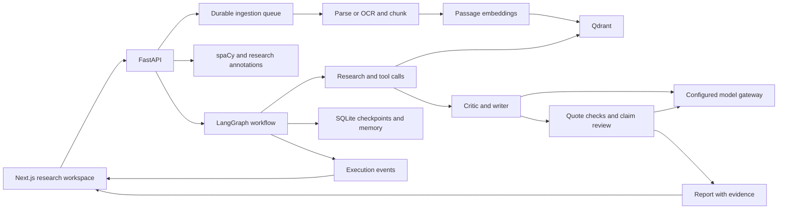

# ResearchOS release evidence

| Phase | Working implementation | Evidence and remaining limits |
|---|---|---|
| NLP | Durable upload and URL jobs, native text and OCR, five chunking strategies, trained and domain NER, relation extraction, conservative coreference, summaries and passage retrieval | Exact domain NER F1 rose from 0 to 0.833 on six labeled spans in four held-out authored examples. The relation set contains three positive triples. Performance on unfamiliar scientific domains needs a larger annotated corpus. |
| Single agent | A LangGraph-managed researcher chooses another search or an answer, remembers observations, and passes its answer to claim review. Execution tools include scoped document reads, opt-in Crossref search and a bounded arithmetic interpreter. | Three frozen questions completed. Numeric programs support assignments and arithmetic. The interpreter has no arbitrary Python, file or network operations. |
| Collaboration | Independent researchers gather evidence and counterevidence, a critic identifies gaps, a writer synthesizes, and verification checks provenance and claim support. Persisted graph cursors support pause and resume. | Single-agent and collaborative strategies both matched all three gold patterns. A live two-paper report cited both papers. The comparison has yet to establish a collaborative quality advantage. |
| Learning | Users can save project presentation preferences, rate a document by report section, enable bounded search-ranking changes, and opt in to project- and document-scoped recall of accepted workflows. | Isolation, persistence and ranking changes are regression-tested. Feedback represents personal usefulness. Improved relevance for real users still requires a held-out user study. Feedback-based LoRA remains optional. |
| Evaluation and release | Same-corpus comparison of plain generation, RAG, single-agent and collaborative workflows. Measured extraction, summary and retrieval metrics. Monochrome Next.js workspace, streaming traces, Docker Compose, browser checks and blind-review tooling. | Pending external activity is participant recruitment and anonymous ratings. Production use beyond a trusted local machine requires authentication, authorization and load testing. |

## Reproduce the experiments

From the repository root, use the Python 3.12 environment with the installed project. Keep training and evaluation separate. Optional encoder experiments require the nlp-bench extra and local model weights.

```sh
python backend/scripts/evaluate_nlp.py --output data/models/ner/my-new-run
python backend/scripts/benchmark_embeddings.py --allow-download
python backend/scripts/benchmark_chunking.py --help
python backend/scripts/evaluate_summaries.py --help
python backend/scripts/compare_strategies.py --output /tmp/researchos-strategies.json
python backend/scripts/review_study.py prepare backend/reports/research-strategy-smoke.json backend/tests/fixtures/research_benchmark.json data/new-review
```

The strategy comparison uses real provider calls and an isolated temporary index. The four live summary runs consumed 644 provider-reported tokens. The reference summaries were source sentences, which favors extraction. On nine retrieval questions, MiniLM reached Recall@3 of 1.00, TF–IDF 0.833 and pooled spaCy features 0.611. On the chunking test, sentence and structure boundaries each reached Recall@2 of 0.889. The semantic and fixed strategies reached 0.778 and 0.667.

Share only participant.json and a separate blank ballot with each volunteer. Keep organizer-key.json private until scoring. Enter integer ratings from 1 to 5 for correctness, source support, coverage and clarity. Run `python backend/scripts/review_study.py score data/new-review/organizer-key.json ballot1.csv ballot2.csv` to count actual ratings. No participant ratings have been collected.

Recorded [agent comparison](backend/reports/research-strategy-smoke.json), [paper checks](backend/reports/researchos-paper-release.json), [NER results](backend/reports/researchos-nlp-seed17.json), [retrieval results](backend/reports/researchos-embedding-benchmark.json), [chunking results](backend/reports/researchos-chunking-benchmark.json) and [summary results](backend/reports/researchos-summary-benchmark.json).

## Class presentation

1. Open Source library and upload a paper. Indexing records page or character offsets so a cited passage can be found again. For isolated demonstration, upload a short text with a unique value.
2. In Language lab enter “BERT was evaluated on SQuAD.” Inspect the two entities, their relation and the source sentence. Show how training and testing use separate labeled examples.
3. In Research desk ask a question about the selected paper. Inspect its answer beside a literal source excerpt, then ask for something the passage cannot establish.
4. In Agent workflows select the collaborative strategy. Follow the two researchers, then the critic and writer. Inspect tool observations, reported token usage and verification. Download the report. A model's support judgment can still be wrong.
5. Close with the measured single-agent comparison and leave time for questions. The small benchmark supports feasibility; it does not establish that additional agents always improve factual accuracy.

## High-level design


