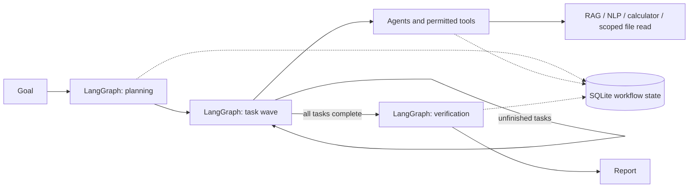

# AURA architecture

AURA is a Python 3.12 research backend. The installable `aura` namespace is retained to keep existing scripts and integrations compatible. `aura.api.application` wires FastAPI, model providers, RAG, NLP, tools, and workflows; `aura.api:app` remains the ASGI entry point. A buildless HTML/CSS/JavaScript dashboard in `frontend/` is served by the same application.

## Concept folders

| Folder under `src/aura` | Responsibility |
|---|---|
| `core/` | Environment settings, sanitized errors, logging policy |
| `api/` | Application composition and lifecycle |
| `nlp/linguistics/` | Shared spaCy tokenization, sentences, lemmas, POS, dependencies, entities |
| `nlp/semantic/` | Similarity using the shared embedding cache |
| `rag/ingestion/` | PDF/text extraction, document metadata, page and source offsets |
| `rag/chunking/` | Source-preserving recursive chunks |
| `rag/embeddings/` | Cloudflare BGE-M3 vectors and SQLite cache |
| `rag/vectorstore/` | Persistent Qdrant collection |
| `rag/retrieval/` | Dense/BM25 fusion, deduplication, reranking, evaluation |
| `rag/generation/` | LangChain document context, typed answers, exact citation checks |
| `rag/prompts/` | Grounded answer instructions |
| `llm/` | Existing model registry, gateway, transport, provider selection |
| `llm/providers/` | AgentRouter OpenCode adapter |
| `agents/` | Role contracts and bounded observe/act workers |
| `agents/tools/` | Scoped tool dispatch, permission and argument checks |
| `agents/verification/` | Exact quotes, provenance, audited numeric comparisons |
| `orchestration/graph/` | LangGraph state, nodes, conditional task-wave routing |
| `orchestration/workflow/` | Budgets, retries, cancellation, recovery, compatibility imports |
| `memory/` | Project-scoped working, episodic, semantic memory and workflow events |
| `database/` | Existing SQLite workflow connection and schema initialization |

Feature-specific HTTP routes stay beside NLP, RAG, and orchestration. No empty intent classifier, language detector, OCR implementation, or unused YAML configuration has been added. Environment settings remain the authoritative configuration. Semantic chunk merging stays in the ingestion pipeline because it uses the existing embedding cache and quota fallback.

## Data flow

1. Upload → extract native text and metadata → chunk → cached embeddings → Qdrant. Document identities, hashes, offsets, vector dimensions, and collection name are unchanged.
2. Query → dense and BM25 candidates → reciprocal-rank fusion → deduplicate → Cloudflare rerank (explicit fallback on service error).
3. Retrieved chunks → lossless LangChain-core `Document` context → configured LLM → typed JSON answer → exact citation validation. LangChain-core is used only at this document boundary; the working provider protocol is unchanged.
4. Goal → LangGraph planning node → one or more bounded concurrent task waves → deterministic verification → persisted report. Tool observations are treated as untrusted data.

## Persistence and recovery

`data/workflows.sqlite` retains goals, workflows, events, and memory with the original schema and transactions. `memory.manager.Memory` is the sole durable workflow state owner; the old `orchestration.workflow.persistence.Memory` import remains compatible. LangGraph control state is transient. Restart reconstructs the graph from saved plans and task results, skipping completed tasks. This is application-level recovery, not LangGraph native interrupt/checkpointer support. No duplicate history store or schema migration was introduced.

`data/embeddings.sqlite` retains the embedding cache, document metadata, and ingestion mutation journal. Vectors stay in `data/vectors`, papers in `data/papers`; no storage migration or re-embedding is required. SQLite and Qdrant are separate stores; existing recovery does not provide a distributed transaction guarantee.

## AgentRouter and limits

The adapter still invokes OpenCode with the configured model, an isolated temporary configuration, and an environment-based key. The base URL remains `https://agentrouter.org/v1`; `.env` controls provider and model selection. CLI NDJSON output supplies text and reported usage. The API buffers generation; it does not expose token streaming. The CLI token limit is expressed in the prompt, not a guaranteed provider-side hard cap. Other providers and existing fallback behavior are retained.

Exact quote checks prove source identity and substring presence, not semantic entailment. NLP needs the optional spaCy English model for full linguistic annotations. No intent classification, language detection, or scanned-PDF OCR is currently implemented. The development API has project scoping but no authenticated multi-user boundary; use localhost and one worker for local Qdrant. Provider availability and current account credits are not established by offline tests.

Implementation reference: [LangGraph graph API](https://docs.langchain.com/oss/python/langgraph/graph-api) and [LangChain Document](https://reference.langchain.com/python/langchain-core/documents/base/Document).

## Dashboard and observability

`frontend/` is a buildless same-origin dashboard served by `api/dashboard.py`. `/monitor/events` exposes cursor-based polling over a bounded event buffer; `/monitor/status` returns sanitized service and integration information; `/monitor/workflows` lists saved runs for a project. Existing upload, query, NLP, and workflow APIs perform all actual work.

`observability/events.py` uses context variables to correlate request traces and workflow IDs, and span IDs to show nested operations. Context follows async tasks and `asyncio.to_thread` calls. The buffer is protected for worker-thread emission. Decorators preserve original function signatures and re-raise errors/cancellation. Telemetry contains explicitly supplied metadata, never automatic argument/result serialization. Workflow lifecycle events continue to persist in the original SQLite store; detailed spans are transient.

The frontend builds DOM text nodes for model/document output instead of inserting untrusted HTML. Exported files are generated in the browser from retrieved results. It polls every 700 ms; this is live event monitoring, not model token streaming or access to hidden model reasoning. No new Python or JavaScript dependency was introduced for the dashboard. Static assets are included in wheel packaging.

Implementation reference: [FastAPI file responses](https://fastapi.tiangolo.com/advanced/custom-response/) for serving the local page and assets.
