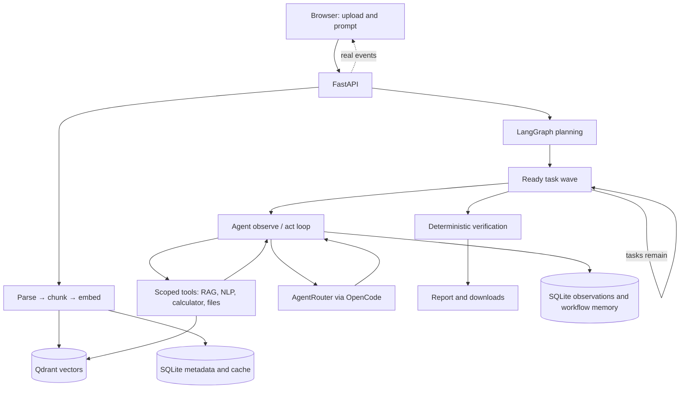

# How AURA works

AURA is a document research assistant, not a trained foundation model. Python services prepare evidence and coordinate a hosted LLM. A browser dashboard calls the same FastAPI routes used by scripts.

## Agents: specialized roles, shared model

| Role | Actual responsibility |
|---|---|
| Planning | Calls the configured LLM for a typed task dependency graph. Pydantic rejects cycles, invalid dependencies and unauthorized tools. |
| Research | Uses scoped `rag_search` or `document_read` tools, then produces a summary with exact quotes and document/chunk IDs. |
| Analysis | Synthesizes checked dependency outputs. Can use permitted calculator, NLP or search tools when assigned. Cannot invent citations. |
| Execution | Executes constrained calculator/document/file operations. It is not a shell or general Python executor. |
| Verification | Deterministic Python checks quote substrings, document scope and audited numeric comparisons. It does not ask an LLM to declare its own answer correct. |
| Reporting | Deterministically assembles dependency summaries and evidence. Final workflow report assembly also records verification, limits and usage. |

A run uses only roles in its plan; all six roles are not forced into every task. Research/analysis/execution workers choose a typed tool action or final answer. Listed task tools are required and must actually execute. Tool results are saved in SQLite. Bounded prompt views deduplicate chunks and shorten visible text while keeping full audit observations intact. Calls, steps, retries, elapsed time and concurrency have explicit limits. Shortened quotes still must match original evidence exactly.

## RAG: finding evidence before writing

1. **Parsing:** PDF native text is extracted with PyMuPDF; TXT, Markdown and CSV are also accepted. Pages, source positions, content hashes and stable IDs are retained. Scanned documents need OCR, which is not implemented.
2. **Chunking:** recursive chunks overlap to retain local context. Optional semantic merging uses embedding similarity between adjacent blocks.
3. **Embeddings:** Cloudflare BGE-M3 produces 1,024-dimensional vectors. SQLite caches vectors by model and content digest, avoiding repeat calls for identical text.
4. **Storage:** Qdrant stores vectors and chunk metadata. SQLite stores documents and ingestion recovery records.
5. **Retrieval:** query embeddings find dense neighbors. BM25 supplies lexical candidates. Reciprocal-rank fusion combines them; duplicates are removed.
6. **Reranking:** Cloudflare reranker orders candidate evidence. A service failure is exposed as a fallback rather than hidden.
7. **Context and generation:** retrieved text/IDs are assembled for the configured hosted LLM, which returns a typed answer and citations. Invalid exact quotes trigger at most one answer retry; persistent invalid citations remain errors.
8. **Verification:** exact quotation checks establish provenance, not whether every sentence logically follows from its citation. Insufficient evidence must be disclosed.

## NLP

One shared spaCy processor provides tokens, sentence boundaries, lemmas, part-of-speech tags, dependency labels and named entities. Full annotations require `en_core_web_sm`; the fallback only supports basic token/sentence processing. Semantic similarity reuses the embedding cache and computes cosine similarity. Intent classification, language detection and OCR are not claimed features.

## LangGraph and LangChain

LangGraph is the actual workflow orchestrator (`orchestration/graph/`). The graph is START → planning → task_wave → verification → END. A conditional edge returns to task_wave while unfinished tasks remain. Each wave runs ready dependencies with bounded concurrency. Engine code owns retries and cancellation. SQLite stores plans, outputs, counters, events and recovery state; restarting reconstructs execution and skips completed tasks. Native LangGraph interrupt/checkpointer APIs are not used.

LangChain-core has a deliberately smaller role: `Document` objects preserve retrieved text and metadata at the answer-context boundary. It is not a second orchestrator and does not replace the existing AgentRouter adapter.

## Runtime boundaries and honest limits

AgentRouter is accessed through OpenCode with temporary configuration and an environment-based key. It returns buffered text and reported tokens. Cancellation kills the child process. Cloudflare AI requests are separate from Cloudflare Tunnel; AURA does not manage tunnels. Dollar cost and remaining credits are unknown. The API is local and unauthenticated, with project scoping rather than a multi-user security boundary. Detailed live events are a 5,000-event memory buffer; saved workflow lifecycle and results persist in SQLite. No deployment, tunnel or public API is created by publishing source to GitHub.
